# Lightsheet Guide: from a 200 GB `.czi` to a clean, stitched, 3-D volume

A step-by-step guide to processing tiled light-sheet data (ZEISS Lightsheet Z.1 `.czi` files) with this pipeline.
No programming is needed: everything is done in one window. The pictures in this guide come from a real cleared
mouse brain (182 GB, 21 tiles, 2 channels, 1041 z-planes).

**Contents**
[1. The big picture](#1-the-big-picture) ·
[2. Install](#2-install-once) ·
[3. Quick start](#3-quick-start-the-10-minute-version) ·
[4. Step by step](#4-step-by-step) ·
[5. Cleaning up the data](#5-what-the-cleaning-steps-do-with-pictures) ·
[6. Denoising: what it costs](#6-denoising-what-it-can-and-cannot-do) ·
[7. Exporting](#7-exporting-to-tiff) ·
[8. Time and disk budget](#8-time-and-disk-budget) ·
[9. Troubleshooting](#9-troubleshooting) ·
[10. How it works (technical)](#10-how-it-works-technical-appendix)

---

## 1. The big picture

A light-sheet microscope cannot image a whole brain at once. It images it in **tiles** (here a 3 × 7 grid, 21 tiles),
each tile being a full 3-D stack, and neighbouring tiles overlap by about 20 %. The ZEN software saves all of them
in one huge `.czi` file. To get one continuous volume you must:

1. **Read** the file without loading 200 GB into memory,
2. **Clean** the data (uneven brightness, streaks, dips),
3. **Stitch** the tiles so features line up in the overlaps,
4. **Look** at it (any plane, any depth, zoom from whole brain to cells),
5. **Export** something small enough to share (tens of GB, or a few GB).

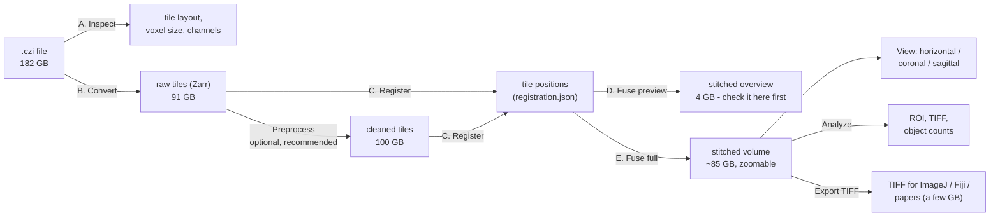

Three ideas make this possible on one workstation:

* **Never load everything.** Data is stored in small chunks (Zarr). Each step touches a few chunks at a time, so
  RAM use stays modest and every step can be **stopped and resumed**.
* **Register small, apply big.** Tile positions are found on a 4×-downsampled copy (fast), then applied to the
  full-resolution data.
* **Keep the raw data.** Cleaning writes a *second* copy of the tiles. Your originals are never modified.

> [!NOTE]
> The window is a viewer ([napari](https://napari.org)) with a control panel on the right. The four tabs are
> **Pipeline**, **Preprocess**, **Analyze** and **Export TIFF**. A histogram sits under the tabs, and a Z-slider with a
> **View** menu runs along the bottom.

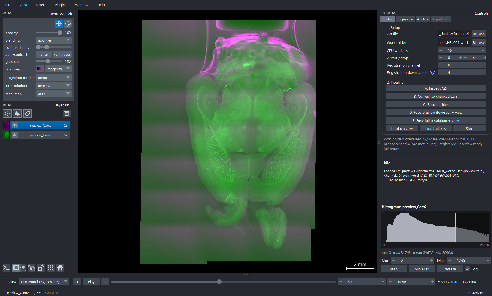

---

## 2. Install (once)

You need **Windows 10/11**, **Python 3.10 to 3.12** from [python.org](https://www.python.org/downloads/) (tick *"py launcher"*
during install), and disk space of about **1.5 to 2× the size of your `.czi`** for the work folder (see
[section 8](#8-time-and-disk-budget)). An NVIDIA GPU is optional (see below). At least 64 GB RAM is recommended.

1. Clone or copy this folder somewhere with a short path, for example `C:\lightsheet-pipeline`.
2. Open **PowerShell** in that folder and run:

   ```powershell
   powershell -ExecutionPolicy Bypass -File setup_env.ps1
   ```

   This creates a private environment (`.venv`), downloads about 2 GB of packages, and runs a built-in self-test of
   the pipeline on synthetic data (under a minute). All checks should pass (`14/14` with a GPU, `12/12` without, because the two
   GPU-comparison checks are skipped).
3. **Optional, NVIDIA GPU:** run `nvidia-smi` and look at *CUDA Version* in the top right. Then use
   `-Gpu cuda13` (CUDA 13.x) or `-Gpu cuda12` (CUDA 12.x):

   ```powershell
   powershell -ExecutionPolicy Bypass -File setup_env.ps1 -Gpu cuda13
   ```
4. Start the program by double-clicking **`run_gui.bat`**.

> [!TIP]
> **What the GPU is for.** We measured it: the GPU gives a ~30× speed-up for **deconvolution** and for the **TV
> denoise** used for display copies. It gives *no* speed-up for the other steps (they are limited by the disk and
> decompression), so the program only uses it where it helps. Everything also works without a GPU.

> [!NOTE]
> If pip stops with `CERTIFICATE_VERIFY_FAILED` (common on institutional networks), the setup script detects this
> and fixes it automatically by installing `truststore`, which makes Python trust the Windows certificate store.

The program remembers your last CZI and work folder in `~/.lightsheet_pipeline.ini`.

---

## 3. Quick start (the 10-minute version)

| # | Where | What to do |
|---|---|---|
| 1 | **Pipeline** tab | Choose the **CZI file** (or its folder) and a **Work folder** on a fast, roomy drive (an SSD). |
| 2 | | For a first trial, set **Z start / stop** to `0` / `100` so everything runs in minutes. Leave `all` for the real run. |
| 3 | | Click **A. Inspect CZI** → check tile count, voxel size, channels in the log. |
| 4 | | Click **B. Convert** → watch the progress bar and ETA. |
| 5 | | Click **C. Register tiles**. |
| 6 | | Click **D. Fuse preview** → the stitched whole sample opens. **Check it for seams and misalignment.** |
| 7 | **Preprocess** tab | Click **Try on region** to preview the cleaning, then **F. Run preprocessing**. |
| 8 | **Pipeline** tab | Re-run **C. Register** and **D. Fuse preview** (now on the cleaned tiles), then **E. Fuse full resolution**. |
| 9 | bottom bar | Use **View** (horizontal / coronal / sagittal) and the Z-slider to explore. |
| 10 | **Export TIFF** tab | Pick a level, 8-bit, **Estimate size**, then **Export TIFF**. |

> [!TIP]
> **Always do a 100-plane trial first** (`Z stop = 100`). Use a *separate work folder* for the trial, because the
> trial's converted tiles only contain those planes. Delete or ignore that folder afterwards.

---

## 4. Step by step

### Step 0: Setup (Pipeline tab → "1. Setup")

| Field | What it means | Typical value |
|---|---|---|
| **CZI file** | The `.czi` (or the folder holding it) | |
| **Work folder** | Where all results go. Needs ~1.5 to 2× the CZI size free. | `…\Sample_work` |
| **CPU workers** | Parallel processes. More = faster until the disk is the limit. Each full-resolution fusion worker uses ~4 GB RAM. | 8 to 16 |
| **Z start / stop** | Use only part of the stack (for trials). `all` = everything. | `0` / `all` |
| **Registration channel** | Which channel is used to find tile positions. Use the brighter, more structured one. | `0` |
| **Registration downsample (xy)** | How much smaller the copy used for registration is. | `4` |

The line under the buttons ("Work folder: converted 42/42 … | registered | preview ready …") always tells you what
already exists in the work folder, so you can see at a glance where you left off.

### Step A: Inspect

Reads only the file's table of contents (seconds). Check the log line, for example:

```
21 tiles, 2 ch ['Cam1', 'Cam2'], 1011 z, px 2.541/7.320 um (xy/z), overlap 0.2
```

It should match your acquisition. Note that **z voxels are ~2.9× taller than xy voxels** here. The viewer
accounts for this automatically.

### Step B: Convert

Streams every tile out of the `.czi` into small compressed chunks (Zarr), plus a 4×-smaller copy used for
registration. One progress bar covers the whole job and shows **percent, elapsed time, ETA and MB/s**.

* **Stop is instant and safe.** Click **Convert** again to resume: finished tiles are skipped, and a half-written tile
  is simply redone. A tile only counts as finished if it was made for the *same Z range*.
* Time on our workstation: **about 32 minutes** for 182 GB (16 workers, SSD).

### Step C: Register (this is the stitching)

The stage positions in the file are only approximate (mechanical error is typically 100 to 300 µm). Registration finds
the true shifts between neighbouring tiles:

1. For every pair of neighbouring tiles, compare their overlap strip (3-D phase correlation on the downsampled copy).
2. Give each pair a **quality score q** (1 = identical, 0 = unrelated).
3. Combine all pairs into one consistent set of tile positions (least squares). Pairs that disagree with the rest
   are dropped one at a time, so a single bad pair cannot drag the mosaic.

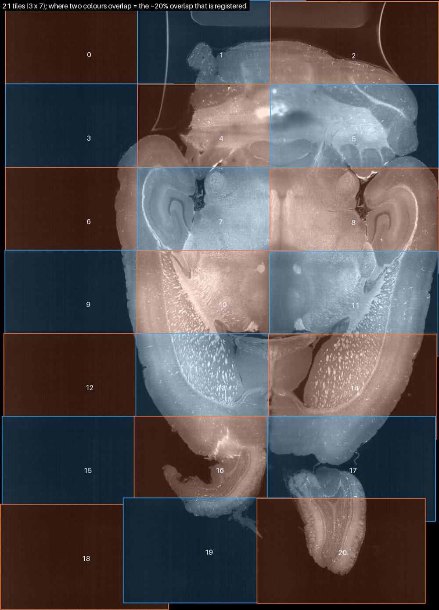

**How to read the log**

```
(example lines from a trial run)
pair 16-17: shift [2.2, 0.5, -6.0] q=0.97 ok
pair 18-19: shift [2.0, -5.8, 2.0] q=-0.11 REJECTED
registration saved: 31/32 links used, max correction 153 px
```

* `shift` = (z, y, x) correction in downsampled pixels (multiply the y and x by 4 for full-resolution pixels).
* `q` above ~0.85 is a confident link. Low-q links often sit where the overlap contains only empty background.
* A few rejected links out of ~30 is normal. If *most* are rejected, check the registration channel and the sample.
* Takes about a minute.

The picture below shows why this matters. It overlays the same overlap strip of two neighbouring tiles
(tile 16 in red, tile 19 in green). With the **stage positions only**, the tiles are offset (red and green
fringes, here ≈ 127 px ≈ 320 µm). After registration the two tiles agree and the overlay turns white.

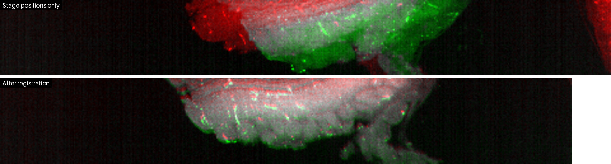

### Step D: Fuse preview, then **look at it**

Blends all tiles into one low-resolution volume (10 µm voxels, ~4 GB) and opens it. This takes only a minute or two,
so it is the place to catch problems *before* the long full-resolution step.

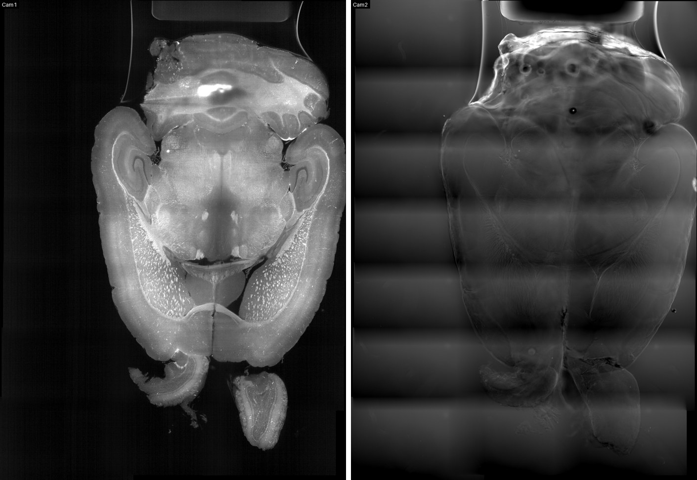

**Checklist at this stage**

* [ ] No visible seams or doubled structures where tiles meet (scroll through several depths).
* [ ] The sample is complete (no missing corner).
* [ ] Both channels are present.
* [ ] Faint **horizontal bands** between tile rows or **dark bands in coronal view**? That is what the Preprocess
  step in [section 5](#5-what-the-cleaning-steps-do-with-pictures) corrects.

### Step "Preprocess" (Preprocess tab): optional but recommended

Cleaning runs per tile, on a copy. The stages, in order:

| Stage | Fixes | Notes |
|---|---|---|
| **0. Plane brightness (z) correction** | Dark bands across single z-planes (illumination dropouts) | No loss of resolution. On by default. |
| **1. Flat-field / shading** | Uneven illumination across the tile | Estimated from the data itself. |
| **2. Destripe** | Vertical (or horizontal) streaks from light-sheet shadows | Choose streak direction `y` or `x`. |
| **3. Deconvolution** | Optical blur | **Off by default** (see the note below). GPU-accelerated. |

**Always try before you commit.** In *Region test* pick a tile, a start plane and a box, tick *"Also preview display
denoise (TV)"* if you like, and click **Try on region**. The viewer shows **raw | preprocessed | (+ TV)** side by side at the same
contrast. Use the **View** menu to look at it in coronal or sagittal too. **Clear test layers** brings your volume back.

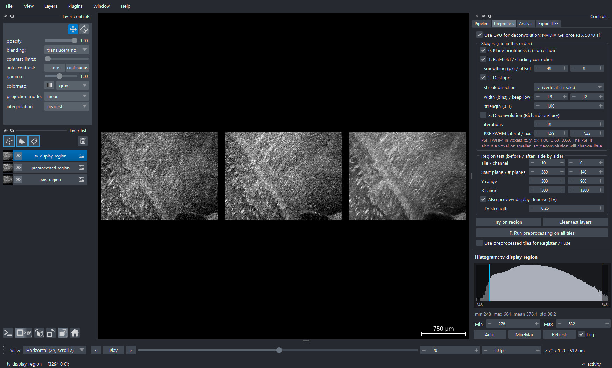

When happy, click **F. Run preprocessing on all tiles** (about 14 minutes on our workstation). It writes `tiles_pp/` and ticks
**"Use preprocessed tiles for Register / Fuse"** for you.

> [!IMPORTANT]
> After preprocessing, **re-run C. Register, D. Fuse preview and E. Fuse full resolution**, so that the stitched
> result is built from the cleaned tiles. Results are saved as `preview_pp.zarr` and `full_pp.zarr`: your earlier
> results are **not overwritten**, so you can compare.

> [!NOTE]
> **About deconvolution.** For this microscope (5×/0.16 NA objective, 7.3 µm light-sheet, 2.5 × 2.5 × 7.3 µm voxels) the
> theoretical blur is **about one voxel or smaller**, so there is little blur to remove, and the window warns you
> of this. Test it with *Try on region* and only run it on all tiles if you see a real benefit. A *broader* PSF (if you have
> measured one) is the usual reason it helps.

### Step E: Fuse full resolution

Builds the full stitched volume (about 85 GB) plus a **pyramid** of smaller versions (2×, 4×, 8×… smaller) so you can
zoom from the whole organ down to single cells smoothly. About 25 minutes on our workstation. The finished volume
opens automatically. **Load preview** / **Load full-res** reload either result later.

If a step was already finished with the current settings, the program asks *"Already done. Re-run it anyway?"*, so
you never recompute by accident.

### Exploring the result

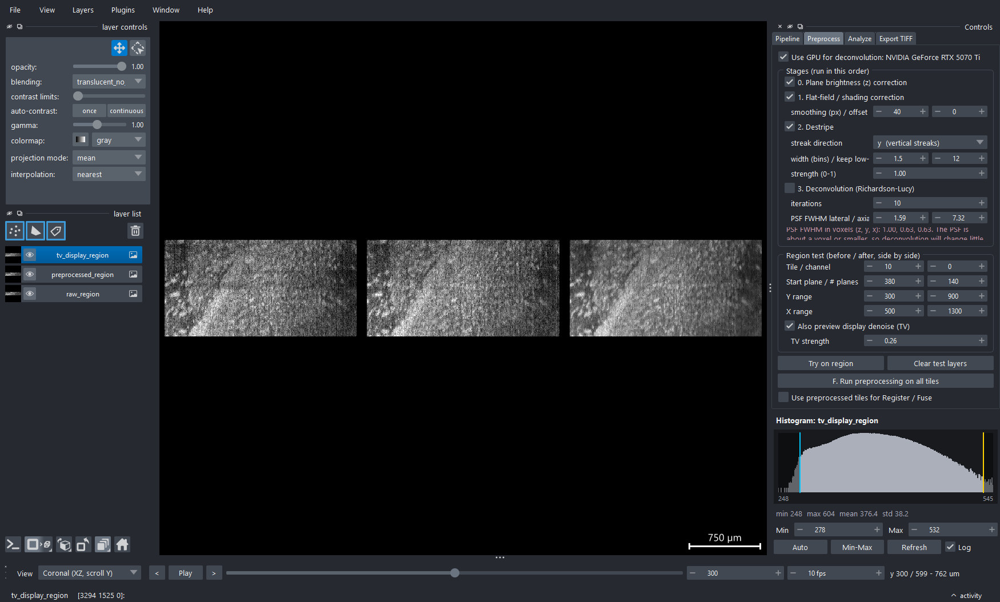

* **View menu (bottom left):** *Horizontal (XY)*, *Coronal (XZ)*, *Sagittal (YZ)*. The slider scrolls through the
  remaining axis. The names assume the sample is mounted as ours was (z = dorsal→ventral, y = anterior→posterior); edit
  `VIEWS` in `lsp/widgets.py` if your orientation differs. No re-processing is needed, because the volume is 3-D.
* **Z-slider with Play/Pause and fps:** scroll or play through the stack.
* **Histogram (right, under the tabs):** shows the brightness distribution of the plane on screen. **Drag the cyan
  (min) and yellow (max) lines**, or type values, to set contrast like in ImageJ. **Auto** = 0.35 %-99.65 %; **Min-Max** = full range.
* **3-D button** (cube icon, bottom left): volume rendering of the coarse pyramid level.

### Analyze tab

Type a source name (`full` or `full_pp`), choose a channel and a **Z / Y / X box in full-resolution voxels**, then:

* **Show ROI box**: draws the box on the volume. **Extract ROI into viewer**: loads just that box at full resolution.
* **Save ROI as TIFF**: saves the box with voxel sizes.
* **Segment + count objects**: smooth → threshold (0 = automatic Otsu) → connected objects, saved as a CSV table
  (position and volume in µm). This is a **generic starting point**. For publication-quality counting use a purpose-built
  tool (Cellpose, StarDist, ilastik) on an exported ROI.

---

## 5. What the cleaning steps do (with pictures)

### 5.1 Dark bands across single z-planes (plane brightness correction)

In coronal or sagittal views, a **dark horizontal band** appeared in our data: a few z-planes were illuminated
less (a laser or sheet dropout). It does not show up in the horizontal view you normally browse. The dimming was **not
uniform across a tile** (50 % of the signal in one corner, under 10 % in the other), so one gain per plane is not enough.
The pipeline estimates a **smooth gain map per plane** on a coarse grid and applies it. It only rescales brightness, so
**resolution is untouched**, and planes without a dip are left almost alone (on real data the average brightness changes by about
0.5 % outside the dips).

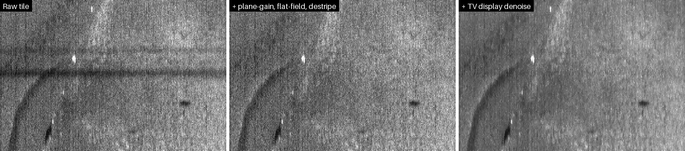

Tile 10 has a milder version of the same problem (the dimming varies from tile to tile):

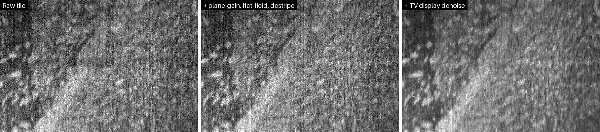

The plot below shows the *average* brightness of each z-plane in a region of tile 10. Raw (red) has three dips; after
the correction (blue) they are gone, while the real, slow brightness trend is kept.

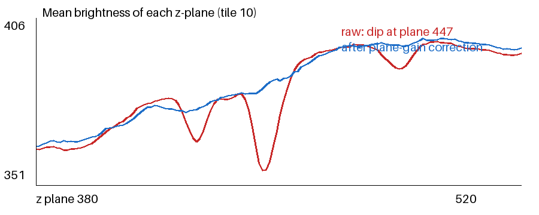

### 5.2 Streaks and shading (destripe + flat-field)

Light-sheet images often carry thin streaks along the sheet direction. Destriping removes them in the Fourier domain and
leaves the rest of the image alone (a synthetic test shows stripe energy dropping from 2.5 to 0.4). Flat-field removes slow
brightness differences across the tile.

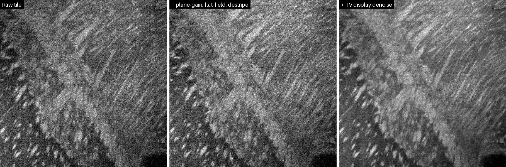

Zoomed in to individual pixels (3×, nearest-neighbour): cleaning does not blur anything. Only the display-denoise
panel on the right looks smoother (see the next section for what that costs).

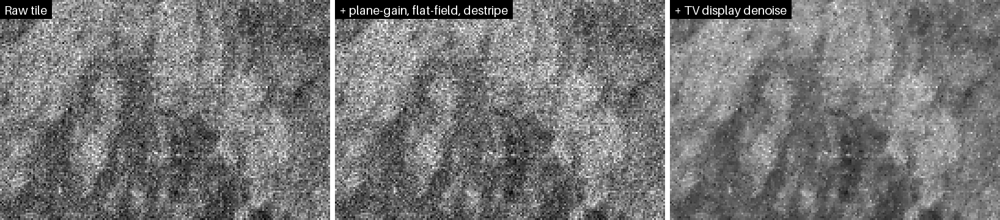

---

## 6. Denoising: what it can and cannot do

We tested this carefully, because "make it less noisy" always has a price. The short version:

> [!IMPORTANT]
> **Noise reduction costs small features.** In this data the smallest real features are only about one voxel across, so
> any filter that halves the noise also dims the finest, faintest structures by roughly a third. Larger structures
> survive well. **No single-image filter can bring back detail that the noise has buried.**
> Therefore: **do quantitative work on the un-denoised data** and use the denoised copy for viewing and figures.

**How we measured it.** We built a test volume with *known* features (point-like spots, bigger blobs, two close spots, fibres, an
edge) on top of noise matching your real data (measured: ≈ 5 counts in the dark background, 15 to 29 counts in tissue;
camera floor ≈ 205 counts). We ran each method at a strength that gives the **same ~2× noise reduction** and
measured what was kept (average of 4 noise realisations):

| Method (≈ 2× less noise) | Fine, point-like spots kept | Medium blobs kept | Large faint blobs kept | Feature width |
|---|---|---|---|---|
| Gaussian blur (σ 0.6 px) | 55 % | 79 % | 99 % | **+28 % wider (blurred)** |
| **TV denoise (w 0.26)** | **66 %** | 68 % | 80 % | **unchanged** |
| Edge-preserving diffusion | ≈ Gaussian | ≈ Gaussian | ≈ Gaussian | wider |

Two more methods could not be tuned that mildly, so they are not on the same footing: **3×3×3 median** (its weakest setting already
reduces noise ~4×) kept only 9 % / 22 % / 32 % of fine / medium / large features and widened them a lot, and **non-local means**
(4 to 11× noise reduction) kept only ~10 to 25 % of features of every size. We do not recommend either for this data.

How strength trades off for **TV** (measured):

| TV weight | Noise reduction | Fine spots kept | Where in the GUI |
|---|---|---|---|
| 0.10 | 1.3× | 86 % | (between Off and Light) |
| 0.15 | ~1.5× | ~80 % (interpolated) | *Light* |
| 0.26 | 2.0× | 66 % | *Medium* |
| 0.34 | 2.8× | 56 % | *Strong* |

**Why TV?** It smooths flat areas but stops at edges, so structures keep their *width* and position; it only lowers the
contrast of the faintest, smallest ones. That is the honest trade-off, and a more benign one than blurring.

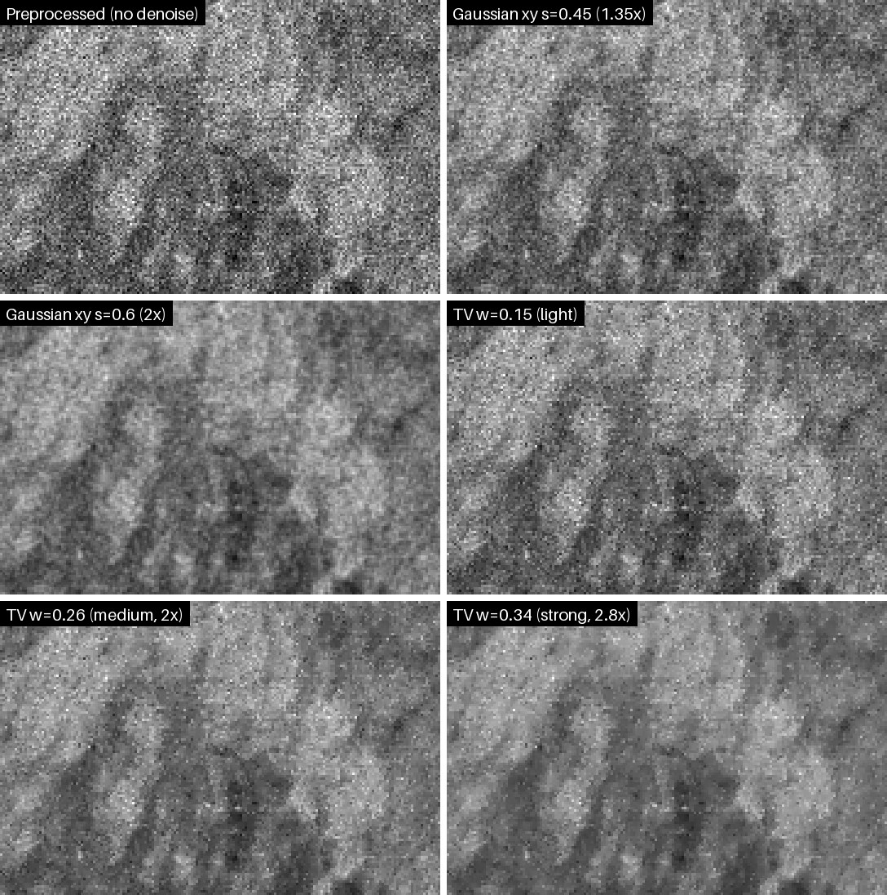

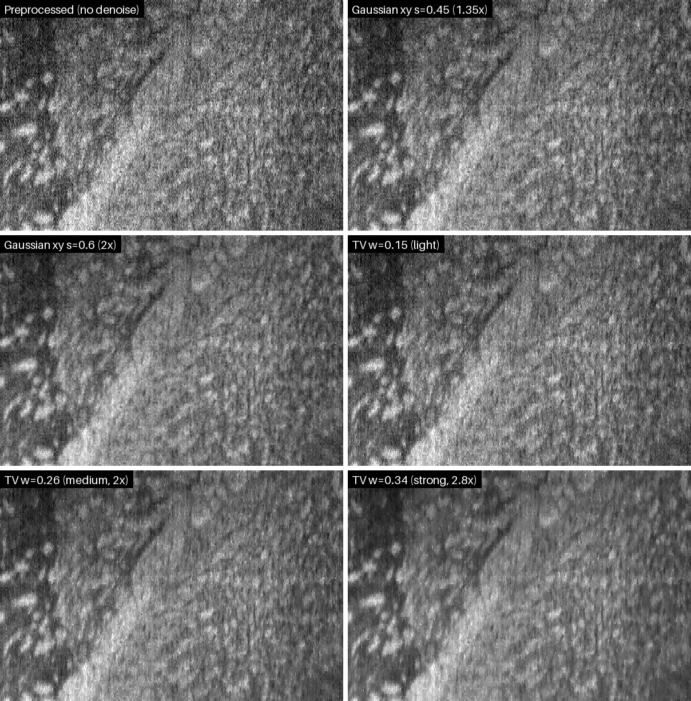

**Recommended practice**

1. Analyse (counts, morphology, tracing) on the **preprocessed, un-denoised** volume (`full_pp`).
2. For figures and browsing, export a **display copy** with *Light* or *Medium* TV (Export tab → *Display denoise*).
3. If you need genuinely better SNR, the fix is at acquisition (more exposure or averaging), or a trained
   deep-learning denoiser (Noise2Void / CAREamics). That is not included here.

---

## 7. Exporting to TIFF

**Export TIFF tab.** Goal: a file small enough to move around (our full dataset is 182 GB; a typical export is a few to tens of GB).

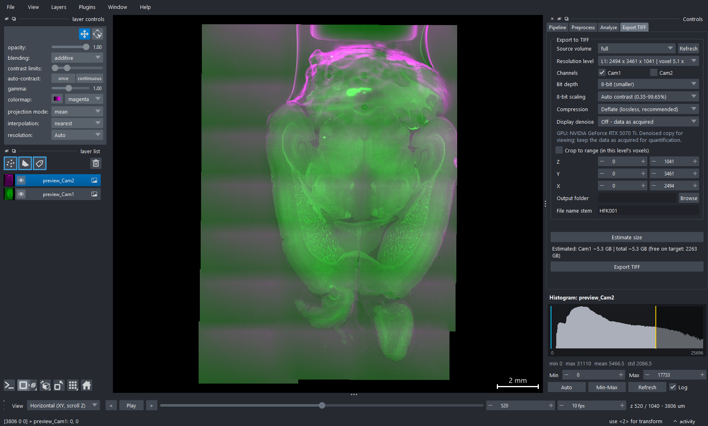

| Setting | Effect on size / quality |
|---|---|
| **Source volume** | `full_pp` (cleaned) or `full` (raw-based) or `preview` |
| **Resolution level** | L0 = full resolution; **each level halves xy** (about ¼ the size). Voxel size is shown. |
| **Channels** | One TIFF per channel |
| **Bit depth** | 8-bit halves the size. 16-bit keeps the full range. |
| **8-bit scaling** | *Auto contrast* (0.35-99.65 %) or *Match viewer contrast* (use the histogram first) |
| **Compression** | Deflate (lossless, recommended) |
| **Display denoise** | Off / Light / Medium / Strong TV, applied to the exported copy only |
| **Crop** | Export only a box |

**Click *Estimate size* first.** It compresses a few real planes with your settings and reports the likely size and free disk space
(within ~3 to 15 % of the real size in our tests). Rough guide for our 1041-plane volume at 8-bit + Deflate:

| Level | Voxel (xy) | Approx. size per channel |
|---|---|---|
| L0 | 2.5 µm | ~20 GB |
| L1 | 5 µm | ~5 GB |
| L2 | 10 µm | ~1.3 GB |

Each export writes `<name>_<channel>.tif` and a small `…_export.json` that records every setting (level, contrast limits, TV
settings), so a figure can always be reproduced.

> [!WARNING]
> The exported files are **BigTIFF** (needed for files over 4 GB). **Plain ImageJ cannot open BigTIFF.**
> Use **Fiji**, or install the **Bio-Formats** plugin into ImageJ and open with *File → Import → Bio-Formats*
> (tick *"Use virtual stack"* for large files). napari, Python (`tifffile`), and most image-analysis programs open them directly.

Exports are written as `*.partial` and renamed when complete, so a cancelled export never leaves a broken file.

---

## 8. Time and disk budget

Measured on our workstation (Ryzen 9 9950X3D 16 cores, 125 GB RAM, NVMe SSD, RTX 5070 Ti) with a 182 GB, 21-tile, 2-channel
dataset:

| Step | Time | Disk written |
|---|---|---|
| A. Inspect | seconds | – |
| B. Convert (16 workers) | ~32 min | 91 GB (`tiles/`) |
| C. Register | ~1 to 2 min | negligible |
| D. Fuse preview | ~1 to 2 min | 4 GB |
| Preprocess (plane-gain + flat-field + destripe, 16 workers) | ~14 min | 100 GB (`tiles_pp/`) |
| E. Fuse full resolution | ~25 min | ~85 GB |
| Export TIFF, L1 8-bit | ~1.5 min per channel | ~5 GB |
| TV display denoise on export (GPU, measured block speed, extrapolated) | ~4 min/channel (L1), ~16 min/channel (L0) | – |

**Space rule of thumb:** raw tiles ≈ 0.5× the CZI; cleaned tiles ≈ another 0.55×; each full stitched volume ≈ 0.45×. So **a complete run with
preprocessing needs about 1.5 to 2× the CZI size**, plus any exports. Once you are happy with the final volume, and do not plan
to re-register or re-fuse, you can delete `tiles/` and `tiles_pp/` to reclaim ~190 GB (the CZI itself is the true raw data, and
convert/preprocess can recreate them).

---

## 9. Troubleshooting

| Symptom | Fix |
|---|---|
| `CERTIFICATE_VERIFY_FAILED` while installing | Re-run `setup_env.ps1`. It installs `truststore` automatically. |
| Window opens but the view is black | Complete step D first, or click **Load preview**. Check the Z-slider is within the volume. |
| "No .czi file in that folder" | Choose the file itself, or a folder that directly contains it. |
| I closed the window mid-step | Re-open and click the same button. **Convert** resumes; **Register/Fuse** restart (they are short; full fusion is ~25 min). |
| **Stop** doesn't react at once | It stops within ~½ s. Worker processes are terminated immediately; if any stray `python.exe` remain, end them in Task Manager. |
| "Already done" prompt | The result exists for the current settings. Choose *No* to load it, *Yes* to recompute. |
| The stitched result looks wrong after preprocessing | You must re-run **Register** and **Fuse** after preprocessing (the registration records which tiles it used). |
| GPU not detected | Run `nvidia-smi`. Re-run `setup_env.ps1 -Gpu cuda13` (or `cuda12`). It is optional; the CPU path works. |
| Out of memory during full fuse | Lower **CPU workers** (each full-fusion worker uses ~4 GB). |
| "non-contiguous tile indices" error | The CZI's tile numbering is irregular; this version expects tiles numbered 0…N-1. |
| TIFF won't open in ImageJ | It is a BigTIFF: use Fiji or the Bio-Formats plugin (see section 7). |
| I moved the work folder | Re-select it in the **Work folder** box (paths are stored by location). |
| Region test: "needs converted tiles first" | Run step B (Convert) first for the same Z range. |

**Self-test:** `python tests/test_core.py` (or `.venv\Scripts\python tests\test_core.py`) checks all core algorithms on synthetic data in
under a minute and should print `14/14 checks passed` (`12/12` without a GPU).

---

## 10. How it works (technical appendix)

**Files in the work folder**

```
Sample_work/
  info.json  project.json            what was inspected / settings used
  tiles/            tileNN_cC.zarr   raw tiles (full-res) + tileNN_cC_low.zarr (4x smaller)
  tiles_pp/         …                preprocessed tiles; gains_tileNN_cC.npy = the plane-gain maps used
  flatfield_cC.npy                    estimated illumination profile
  registration.json                   tile offsets + every pairwise shift/quality
  fused/preview.zarr, full.zarr       stitched volumes (+ _pp versions); OME-NGFF multiscale
  exports/                            TIFFs
```

**Convert.** Each (tile, channel) is read plane by plane and written as 32×256×256 zstd chunks; a marker file records the Z range
it was made for. 16-bit throughout.

**Register.** Per overlap: crop both tiles, band-pass (difference of Gaussians) and taper them, then 3-D phase correlation
(sub-pixel). The correlation is validated by the Pearson *r* after alignment (*q*). Offsets come from a weighted least-squares
solve over all pairs; the worst-fitting pair is removed repeatedly until all remaining pairs agree. Translation-only, which is
sufficient for tiles from one stage. Offsets are rounded to whole voxels for fusion.

**Fuse.** The output canvas is built block by block; each block reads only the tiles that overlap it and blends them with a linear
feathering weight across the overlap (weights normalised). Chunks are written in parallel, then a mean-pooled pyramid is added.
OME-NGFF metadata is written last, so an interrupted fusion is never mistaken for a finished one.

**Plane-gain.** Per tile, the low-res stack gives the mean signal (mean − camera floor) in a 4×6 grid of blocks for every plane. The
reference level is a 61-plane running median per block (unbiased on slow trends and robust to dips under ~half that width). The gain
is reference ÷ measured, limited to 0.9 to 2.2 and set to 1 within 1 %, and for blocks with almost no signal. Gain maps are interpolated
bilinearly and applied about the **camera floor** (estimated as the 20th percentile of per-tile 0.1th percentiles, so all-tissue tiles
borrow it from the others).

**Flat-field.** Median over sampled planes of all tiles → Gaussian smoothing → normalised to mean 1; applied as a division.

**Destripe.** Per plane: FFT, attenuate a narrow band along the frequency axis perpendicular to the streaks (keeping low frequencies),
inverse FFT. Same code in the region test and the full run.

**Deconvolution.** Richardson-Lucy with FFT-based convolution (cost independent of PSF size; CPU and GPU agree to <0.002 counts). The PSF
is a Gaussian built from the objective NA, emission wavelength and the sheet thickness in the CZI metadata, or your own FWHM values.

**TV denoise.** Chambolle's dual-projection algorithm (identical to scikit-image's up to its early stopping, <0.07σ), fixed 60 iterations,
run on the GPU in overlapping 1024² blocks with a 4-plane z-halo; strengths are in units of the tissue noise σ, which is estimated from
the data (MAD of second differences over tissue pixels).

**Reproducibility.** `project.json`, `registration.json`, `gains_*.npy`, `flatfield_*.npy` and each export's `…_export.json` record
what was done. The `evaluation/` folder contains the scripts behind the numbers and pictures in this guide (set `LSP_WORK` to a
work folder to re-run them).

**Limitations.** One time point; tile grids from the ZEN "bounding grid" with 0…N-1 numbering; translation-only registration; no
per-tile intensity matching beyond the corrections above; deconvolution uses an approximate (Gaussian) PSF; denoised exports are
for display, not measurement.
